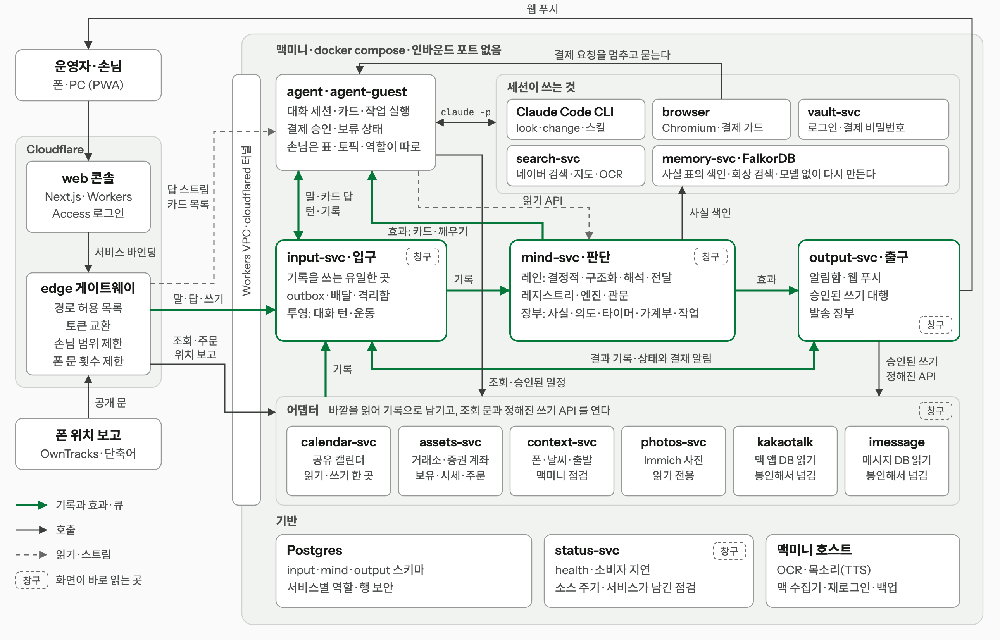
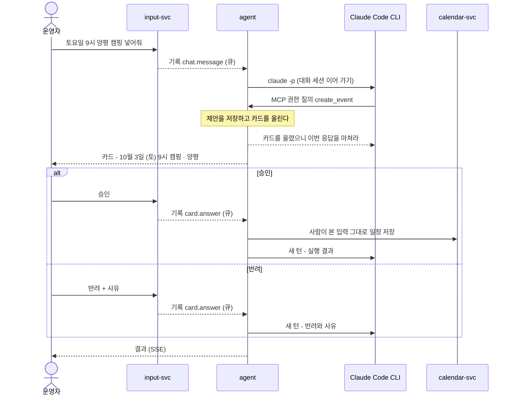

# jarvis

대화 하나로 일정·가계부·자산·브라우저 심부름을 맡기는 개인 AI 비서입니다.
**모델은 제안만 하고, 일정이나 결제처럼 바깥을 바꾸는 일은 사람이 카드를 승인해야 실행됩니다.**

혼자 설계하고 만들어 2026년 9월부터 매일 쓰고 있습니다. 집의 맥미니에서 돌고, 인터넷을 향해 열린 포트는 하나도 없습니다.

- **기간** 2026-09-19 ~ 운영 중 · 1인 설계·개발·운영 (Claude Code 활용)
- **규모** 커밋 360여 개 · Go 약 11만 줄 · TypeScript 약 3.7만 줄 · Python 약 6천 줄 · SQL 마이그레이션 98개 (2026-10-31 기준, 테스트 포함)
- **구성** Cloudflare Workers 2개(웹 콘솔·게이트웨이) + 맥미니 docker compose 서비스 20개 + 사진 서버(Immich)
- **검증** 테스트 파일 약 200개, 인지 루프 평가 시나리오 66개, 결제 재생 시험, 서비스별 DB 역할 시험
- **스택** Go · Next.js(TypeScript) · Python · PostgreSQL · FalkorDB · Docker Compose · Cloudflare Workers / Workers VPC / Access · Claude Code CLI · MCP

## 할 수 있는 일

| 영역 | 예 |
|---|---|
| 일정 | "토요일 9시 양평 캠핑 넣어줘" → 카드 `10월 3일 (토) 09:00 캠핑 · 양평` 승인 → 공유 캘린더에 저장. 카카오톡 대화에서 약속이 확정되면 먼저 "캘린더에 넣을까요?"라고 묻습니다 |
| 가계부 | 카드사 카카오톡 알림을 읽어 자동으로 기록합니다. 분류를 모르는 결제만 카드로 묻고, 쿠팡 결제는 브라우저로 주문 목록을 읽어 상품별로 나눕니다 |
| 자산 | 거래소·증권 계좌·금 조회. 목표 비중에서 벗어나면 리밸런싱 카드를 올립니다 |
| 브라우저 심부름 | 맡긴 일을 백그라운드 작업으로 돌립니다. 결제 직전에 카드를 올리고, 승인하면 보안 키패드 비밀번호까지 넣어 결제를 끝냅니다 |
| 찾아보기 | 네이버 블로그·뉴스·카페·웹을 함께 찾고, 페이지 속 그림(이벤트 카드·높이 2만 픽셀의 상품 상세 이미지)에 쓰인 글자까지 읽어 답합니다. 근처 가게는 네이버 지도의 영업 상태·마감 시각·별점으로 찾습니다 |
| 먼저 말 걸기 | 결제·운동·사진·위치·대화에서 생활 패턴을 찾아 제안합니다 - "11/15 캠핑. 지난번엔 3일 전에 장작을 샀어요. 담아둘까요?" 야외 일정에 비 예보가 있으면 맑은 날로 옮기자고 묻습니다 |
| 그 밖에 | 리마인드(시각, 집 도착·출발)와 체크리스트, 장기 기억(지식 그래프), 운동 기록, 사진(Immich), 버스·지하철 출발 카운트다운, 하루 동선 되감기, 웹 푸시 알림, 목소리 복제 TTS, 자기 대화·작업·리마인드와 공유 캘린더를 쓰는 손님 계정 |

## 구성

<p align="center">
  <a href="docs/architecture-light.png">
    <picture>
      <source media="(prefers-color-scheme: dark)" srcset="docs/architecture-dark.png">
      
    </picture>
  </a>
</p>

초록 선이 기록과 효과가 큐로 지나는 길입니다. 화면의 쓰기, 대화에서 한 말, 카드의 답, 수집한 메시지, 어댑터의 소식이 모두 입구에서 기록이 되고, mind 가 그 기록을 읽어 효과를 냅니다. 창구 표시가 있는 곳은 화면이 큐를 거치지 않고 바로 읽습니다.

웹 콘솔과 게이트웨이만 Cloudflare 에 있고 나머지는 전부 맥미니에 있습니다. 터널은 바깥으로 나가는 연결만 맺습니다.

### 구조의 규칙

- **입구 하나.** 기록(`input.records`)을 쓰는 프로세스는 `input-svc` 하나입니다. 다른 서비스는 `input.outbox` 에 넣기만 하고, 화면의 쓰기와 대화에서 한 말과 카드의 답도 먼저 기록이 됩니다.
- **판단 하나.** 먼저 말을 걸지의 판단과 그 장부는 `mind-svc` 에 있고, mind 의 상태는 기록으로만 바뀝니다. 누가 기다리는 카드의 답은 판단이 아니라 전달이라, 에이전트가 기록에서 바로 읽어 이어 갑니다.
- **사실 하나.** `mind.facts` 표가 원천이고 운영자의 기억 그래프는 이 표에서 모델 호출 없이 다시 만드는 색인입니다. 비밀은 보관함에만 두고 기록에는 넣지 않습니다.
- **종류는 데이터.** 기록의 종류, 행동의 수준, 슬롯, 소스의 기대 주기가 `mind.registry` 표의 줄입니다. 줄이 없는 종류는 받아서 알리고, 줄이 없는 행동은 실행하지 않습니다.
- **손은 세 자리.** 바깥을 바꾸는 곳은 셋입니다. mind 가 올린 일을 허용 목록의 API 로 대신 부르는 output, 가드가 붙은 브라우저, 사람이 승인한 카드를 실행하는 에이전트입니다.
- **읽기는 바로, 쓰기는 기록으로.** 조회는 mind 의 읽기 API, 입구의 투영, 어댑터의 조회 문이 바로 답합니다. 바꾸는 일은 기록으로 보내서, 받을 쪽이 내려가 있어도 일이 사라지지 않습니다.

화면이 기록을 거치지 않고 바로 보내는 쓰기는 목록으로 둡니다. 자산 주문과 원금 기록은 `assets-svc`, 알림 설정은 `output-svc`, 폰 영역과 출발 경로는 `context-svc` 로 갑니다. 비밀 칸이 있는 카드의 답은 비밀이 기록에 남지 않게 에이전트로 바로 갑니다.

### 서비스

| 서비스 | 자리 | 하는 일 |
|---|---|---|
| `web` | Cloudflare | 폰에서 쓰는 PWA 콘솔. 토큰은 서버 쪽에만 있습니다 |
| `edge` | Cloudflare | 경로 허용 목록을 확인하고 서비스용 토큰으로 바꿔 붙입니다 |
| `input-svc` | 입구 | 기록, 소비자별 배달, 격리함, 대화 턴과 운동의 투영 |
| `mind-svc` | 판단 | 레인별 소비, 레지스트리, 엔진, 관문, 사실·의도·타이머·가계부·작업 장부 |
| `output-svc` | 출구 | 알림함, 웹 푸시, 발송 장부, mind 가 올린 일의 승인된 쓰기 |
| `agent`, `agent-guest` | 도구 | Claude Code 세션, 카드, 작업 실행, 결제 승인과 보류 상태 |
| `browser` | 도구 | 로그인된 Chromium. 가드가 결제 요청을 네트워크에서 멈추고, 작업이 사이트 밖으로 나가면 막습니다 |
| `search-svc` | 도구 | 네이버 검색, 페이지와 그림 속 글자, 네이버 지도 |
| `vault-svc` | 도구 | 로그인과 결제 비밀번호. 모델은 값을 보지 못합니다 |
| `memory-svc`, FalkorDB | 도구 | 사실 표의 색인과 회상 검색 (Graphiti) |
| `calendar-svc` | 어댑터 | 공유 캘린더의 읽기와 쓰기를 한 프로세스가 맡습니다 |
| `assets-svc` | 어댑터 | 보유, 시세, 입출금, 사람이 확인한 주문 |
| `context-svc` | 어댑터 | 폰 위치, 날씨, 출발 정보, 맥미니 점검 |
| `photos-svc` | 어댑터 | 사진 서버를 읽어 바뀐 것을 기록으로 남깁니다 |
| `kakaotalk`, `imessage` | 어댑터 | 맥의 앱 DB 를 읽기만 하고 메시지를 봉인해 넘깁니다 |
| `status-svc` | 기반 | health, 소비자 지연, 소스의 기대 주기, 서비스가 남긴 점검을 읽어 상태를 판정합니다 |
| Postgres | 기반 | 서비스별 역할로 접속하고, 손님과 에이전트에는 행 보안을 겁니다 |

### 요청이 지나는 길

- **대화 한 턴.** 화면의 말이 입구에서 봉인된 기록이 되면 에이전트가 큐에서 집어 글을 읽고 Claude Code 세션을 잇습니다. 세션은 `look` 으로 읽고 `change` 로 남깁니다. 답은 에이전트의 SSE 로 화면에 오고, 턴은 입구의 투영에 남습니다.
- **카톡 한 줄이 일정이 되기까지.** 수집기가 메시지를 봉인해 입구로 넘기면 mind 의 해석 레인이 읽고, 인용이 원문에 있을 때만 세계 모델에 적습니다. 관문을 지나면 카드가 효과로 나가 화면에 뜹니다. 승인되면 output 이 `calendar-svc` 의 정해진 API 를 부르고, 결과가 기록으로 돌아와 장부를 닫습니다.
- **화면에서 일정 고치기.** 수정은 입구에서 `manual.edit` 기록이 되고, mind 의 결정적 레인을 지나 output 이 `PATCH /events/{id}` 를 부릅니다. 새 일정은 대화와 카드로만 만듭니다.
- **어댑터의 소식.** 어댑터는 바깥을 읽어 달라졌을 때만 기록을 남기고, mind 의 구조화 레인이 모델 없이 규칙으로 받습니다. 화면은 같은 어댑터의 조회 문을 바로 읽습니다.
- **상태와 결재 알림.** 판단이 필요 없는 소식이라 output 이 기록에서 바로 읽어 내보냅니다. mind 가 내려가 있어도 장애 알림은 나갑니다.

## 설계에서 풀어 낸 문제

### 1. 모델은 제안만 한다 - 결재 게이트

LLM 에게 캘린더 쓰기나 결제 같은 도구를 주면 실행 시점을 모델이 정합니다. 실행 직전에 사람이 끼어들 자리가 필요했습니다.

Claude Code CLI 의 `--permission-prompt-tool` 로 권한 질의를 에이전트의 MCP 엔드포인트로 돌렸습니다. 이 플래그는 `--help` 에 없는 숨은 플래그라 실제 컨테이너에서 동작을 확인하고 썼습니다. 핸들러는 카드를 올리고 **바로 답해 턴을 끝내고, 사람의 결정이 다음 턴을 엽니다.**



- **제안은 대화의 속성이 아니라 저장되는 객체입니다.** 그래서 대화 중의 권한 질의뿐 아니라 결제 가드와 인지 루프(mind)도 같은 카드를 올릴 수 있습니다.
- **선언 하나가 세 곳을 정합니다.** 모듈이 동작을 `action.Spec` 으로 선언하면 MCP 도구 스키마, 카드 문구, 되돌릴 수 있는지(`Reversible`)가 한꺼번에 정해집니다. 되돌릴 수 없는 동작은 신뢰도가 아무리 높아도 카드를 거칩니다.
- **승인한 것과 실행한 것이 같습니다.** 승인되면 모델에게 다시 시키지 않고 에이전트가 사람이 본 입력 그대로 실행합니다. CLI 자체 도구는 그 인자의 호출 한 번만 허가하고, 인자를 하나라도 바꾸면 새 카드가 올라갑니다.
- **그래도 안 되는 것은 규칙으로 막습니다.** CLI 의 PreToolUse 훅이 모든 세션의 모든 도구 호출 직전에 정책을 묻습니다. 등록하지 않은 도구, CLI 설정 파일 쓰기, 손님의 폴더 밖 접근, 승인 없는 결제 비밀번호 입력은 실행되지 않습니다.
- **우회로를 없앴습니다.** 캘린더가 에이전트 작업 폴더의 JSON 파일이던 때는 CLI 의 `Read`/`Write` 도구가 카드를 건너뛰는 두 번째 문이었습니다. 저장소를 서비스로 빼서 에이전트의 파일시스템에 캘린더가 아예 없게 했습니다.
- **카드 피로를 줄였습니다.** 운영하면서 카드는 바꾸는 일(일정 추가·수정·삭제, 로그인 저장)과 결제에만 남겼습니다. 조회는 `look` 하나로, 내 목록 안에서 끝나는 리마인드와 체크리스트는 `change` 하나로 카드 없이 지나갑니다. 카드 본문은 JSON 이 아니라 "항목: 값" 줄로 그립니다.
- **함정:** 처음에는 핸들러가 결정이 날 때까지 반환하지 않았습니다. 그런데 CLI 의 HTTP 클라이언트는 `MCP_TOOL_TIMEOUT` 과 상관없이 MCP 호출을 5분 뒤 포기해서, 카드를 5분 넘게 두면 실패로 돌아온 호출을 모델이 다시 시도해 같은 카드가 두 장 떴습니다. 지금은 CLI 에는 거절로 답하되 문구로 "아직 실행도 반려도 아니니 응답을 마쳐라"라고 알립니다.

### 2. 결제는 도구가 아니라 요청을 본다 - 브라우저 가드

`browser_click` 은 조회 버튼이든 결제 버튼이든 같은 호출이라, 도구 층에서는 결제를 가려낼 수 없습니다.

- 같은 Chromium 에 CDP 로 따로 붙은 감시자([`browser/guard.py`](browser/guard.py))가 브라우저가 **실제로 보내려는 요청**을 `Fetch` 로 멈춰 세웁니다. 정해 둔 결제 수단으로 가는 요청은 카드를 띄우고 그 밖의 간편결제는 묻지 않고 막습니다. 반려하면 요청이 취소되는 것이 아니라 애초에 나가지 않습니다. 어떤 도구가 눌렀든 걸립니다.
- 쿠팡 주문서는 결제수단 선택과 결제하기가 같은 주소로 가서, 요청 본문의 이벤트 이름으로 둘을 가립니다.
- 결제 수단은 네이버페이·신용카드·쿠팡 쿠페이이고, 어느 것이든 결제는 승인 카드를 거칩니다. 쇼핑몰의 '신용카드'가 여는 PG 결제창과 카드사 창은 창을 여는 요청에서 카드를 띄우고, 큰 쇼핑몰의 자체 결제 경로도 막지 않고 묻습니다. 결제창 안에서 어느 길로 돈이 나가는지는 주소로 가릴 수 없어서, 승인 하나가 그 결제의 결제창·카드사 창과 그 안에서 고른 네이버페이를 한 건으로 덮고, 다른 간편결제·휴대폰 결제는 승인 뒤에도 막습니다. 카드에는 결제창이 받은 금액과 상품 이름이 보이고, 승인은 그 금액에 묶입니다.
- 카드를 기다리는 동안 멈춘 결제 요청은 2분까지 그대로 기다려서, 그 안에 승인하면 주문서를 다시 칠 것 없이 이어집니다. 결제창 자리에는 Chrome 오류 화면 대신 자비스 안내 화면('결제 승인 대기', '허용하지 않은 결제 수단', '작업의 사이트 밖')이 뜹니다.
- 결제 승인 하나는 결제 한 건입니다. 카드를 올린 쪽(대화, 또는 그 작업)과 그 사이트에만, 결제자가 다시 진행을 시작한 때부터 10분 열리고, 결제하기는 한 번 지나갑니다. 승인과 보류는 에이전트의 [`holder`](agent/internal/holder/payments.go) 한 곳에만 있어 가드는 멈춘 요청마다 에이전트에 묻습니다.
- 카드의 답은 입구의 기록을 에이전트가 큐에서 바로 읽습니다. mind 가 내려가 있어도 승인한 결제는 이어지고, mind 는 나중에 장부만 닫습니다.
- 주문자·배송지는 보관함에 카드로 한 번 저장해 주문서에 그대로 쓰고, 결제 카드는 작업이 남긴 배송지가 저장된 것과 다르면 맨 앞에 경고합니다.
- 아무도 보지 않는 백그라운드 작업은 탭이 작업의 사이트 밖으로 나가면 막습니다. 읽은 페이지가 어디로 가라고 하든(프롬프트 인젝션) 로그인된 브라우저가 엉뚱한 곳에 가지 않게 하려는 것입니다.
- 쿠페이 보안 키패드는 숫자가 글자가 아니라 매번 배치가 섞이는 스프라이트 그림입니다. 그림을 칸마다 잘라 숫자를 읽고, 하나라도 확실하지 않으면 넣지 않습니다(틀리면 결제 비밀번호가 잠깁니다). 모델은 도구를 부르기만 하고 비밀번호를 보지 못합니다.
- 네이버페이 키패드도 같은 도구가 넣습니다. 결제 비밀번호는 대화의 저장 카드(비밀 칸 하나)로 보관함에 넣고, 그 결제 호스트의 키패드 앞에서만 꺼냅니다. 키패드가 있는 프레임의 출처가 결제 호스트일 때만 넣고 - 같은 도메인이어도 블로그·카페는 아닙니다 - 키는 누를 때마다 배치를 다시 읽고, 그 자리를 다른 것이 덮고 있지 않은지 본 뒤 누릅니다.
- 로그인 보관함([`vault-svc`](vault-svc/README.md))도 같은 원칙입니다. 저장은 카드의 비밀 칸으로 받고, 채울 때는 브라우저가 지금 탭의 도메인을 직접 읽어 **그 도메인에 저장된 것만** 받아 넣습니다. 모델은 자격 증명을 한 번도 보지 않습니다.
- 결과: 대화로 맡긴 쿠팡 구매를 작업이 결제 카드 → 승인 → 키패드 입력까지 끝냈습니다(2026-10-18).

### 3. 들어오는 문을 하나로 - 입구와 큐

기능마다 서비스를 두던 구조는 운영할수록 무거워졌습니다. 기능 하나가 서비스·에이전트 모듈·탭 백엔드·mind 코드 네 곳에 걸쳤고, 신뢰도 상수가 수십 곳에 흩어졌고, 이사 한 번이 기억 그래프·집 영역·배송지 세 곳을 바꿔야 했습니다. 그래서 일이 들어오는 문, 판단하는 곳, 사실의 원천을 하나씩으로 줄였습니다.

- **브로커 없이 Postgres 로 큐를 만들었습니다.** 서비스는 `input.outbox` 에 INSERT 만 하고, `input-svc` 가 봉투를 확인해 기록과 소비자별 배달 행을 한 트랜잭션에 씁니다. 소비자는 [`gocommon/queue`](gocommon/queue/queue.go) 로 `SKIP LOCKED` 와 리스로 집고, 처리 하한선 커서로 순서를 지킵니다. LISTEN/NOTIFY 는 깨우기만 합니다. 프로세스가 하나 늘지 않고, 기록과 배달이 어긋날 틈이 없습니다.
- **mind 는 기록을 네 레인으로 읽습니다.** 명령·카드의 답·타이머·화면의 수정은 결정적 레인, 어댑터의 소식은 규칙으로 읽는 구조화 레인, 대화는 모델이 읽는 해석 레인, 다른 서비스의 문구는 그대로 넘기는 전달 레인입니다. 모델이 느려도 화면의 수정은 기다리지 않습니다.
- **화면의 쓰기도 같은 길입니다.** 입구가 기록을 남기고 결정적 레인의 결과를 읽어 답합니다. 왕복은 약 30ms 입니다. mind 가 내려가 있으면 202 로 답하고 기록은 남습니다.
- **늦은 해석이 사람의 답을 덮지 않습니다.** 해석은 모델이 읽기 시작할 때 본 판에만 씁니다. 그 사이 사람이 고쳤으면 한 번 다시 읽습니다.
- **대상별로 나눴습니다.** 손님은 기록·효과 토픽과 표, DB 역할이 따로입니다. 에이전트의 역할은 행 보안으로 기록 중 말과 카드의 답만 읽고, 말의 글은 봉인돼 있어 입구에서 받아 읽습니다. 에이전트에는 봉인 키가 없습니다.
- **어댑터는 판단하지 않습니다.** 바깥을 읽어 달라진 것을 기록으로 남기고([`gocommon/watch`](gocommon/watch)), 조회 문과 정해진 쓰기 API 만 엽니다.

### 4. 먼저 말을 거는 비서 - 인지 루프 (mind-svc)

기능마다 "이럴 때 알려 줘"를 붙이면 알림이 늘수록 방해가 됩니다. 언제 말을 걸지 판단하는 곳이 하나여야 했습니다.

```
기록 → 레인 → 세계 모델 → 스킬 → 엔진 → 관문 → 효과
```

행동의 결과도 기록으로 돌아와 같은 길을 지납니다.

- **근거 없는 해석은 버립니다.** 카카오톡·iMessage 대화를 방이 조용해질 때 덩어리로 모델에 주고, 일정 변경마다 원문 줄 번호와 인용을 받습니다. 인용이 그 줄에 실제로 있어야 세계 모델에 반영합니다.
- **사람에게 닿는 문은 하나입니다.** 모든 제안이 자율성 관문을 지납니다. 최근에 같은 주제를 물었으면(제안 3일·승인 7일·거절 14일) 다시 묻지 않고, 하루 카드 5장·알림 8개로 묶습니다. 고친 확신에 가치를 곱한 값이 방해 비용을 넘을 때만 지금 울리고, 아니면 저녁 요약으로 미룹니다. 방해 비용은 그날 카드가 늘수록 커집니다.
- **확신은 장부로 고칩니다.** 판단 하나에 결과 한 줄을 남기고, 모델이 말한 확신을 그 기록으로 보정합니다. 운영 판단 81건을 실제 발생으로 다시 채점해 보니 예측은 보정이 맞았지만(말한 41%, 실제 44%) 일정 추가 카드는 크게 어긋나 있었습니다(말한 66%, 실제 21%). 보정은 앞선 답만 보는 시간순 시험을 통과한 뒤 켰습니다(운영 카드 37건 Brier 0.351 → 0.257).
- **행동은 네 등급입니다.** 침묵, 비워서 묻기, 채워서 묻기, 하고 알림. 답이 5건 쌓이기 전에는 묻기를 넘지 않고, 보정한 값이 90% 를 넘어야 하고 알립니다. 되돌릴 수 없는 일은 영원히 묻습니다. 거절이 쌓여 10% 아래로 간 종류는 침묵하되 열에 하나는 물어 돌아올 길을 남기고, 침묵했는데 사람이 직접 했으면 놓친 것으로 셉니다.
- **한 번 받은 답은 다음에 채워서 묻습니다.** 배송지 같은 슬롯은 수명이 있습니다. 한 번 받은 배송지는 이사가 있을 때까지 유효하고, 이사가 들어오면 다시 확인합니다.
- **예측은 모델 없이 셉니다.** 결제·운동·사진·위치·작업의 모든 발생을 일반에서 구체로 가는 키(`purchase` → `purchase/식비` → 가맹점)로 읽고, 밤마다 세 가지 꼴의 규칙을 찾습니다 - 요일(피셔 정확 검정), 주기, A 뒤의 B(이항 검정). 찾은 규칙은 그 이전 기록만으로 과거를 맞혀 보는 백테스트를 거친 뒤 "검증 중"으로 조용히 예측하고 채점받습니다. 평소 빈도만 아는 기준선보다 오차가 15% 이상 적고 60% 이상 맞혀야 화면에 보여 주고, 기준선보다 나빠지면 예측을 멈춥니다.
- **상식은 한 번만 묻습니다.** "이 장작이 그 캠핑을 위한 것인가"는 특정 구매가 아니라 (상품 분류, 일정 종류) 쌍으로 모델에 한 번 묻고 표에 남깁니다. 그 위에 시간 거리·배타성·반복을 규칙으로 곱합니다.
- **지금 상황**(어디서 누구와)도 결제·사진·일정으로 규칙 계산해 신뢰도와 함께 대화 매 턴 앞에 붙이고, 0.5 미만이면 추측하지 말고 묻게 합니다.

### 5. 프롬프트는 평가로 바꾼다

- 정답이 적힌 대화 시나리오 66개([`mind-svc/internal/eval/scenarios`](mind-svc/internal/eval/scenarios))를 기록된 모델 응답으로(모델 없이, 결정적) 또는 실제 모델로 돌립니다.
- 정확도만이 아니라 비서다움을 잽니다: 예측의 Brier 점수, 답한 카드의 승인율, 카드가 나온 날의 하루 방해 횟수.
- 프롬프트나 모델을 바꾸면 실제 모델 평가부터 돌립니다. 예: 2026-10-11 Haiku 5.5 로 당시 12개 시나리오를 3번 연속 모두 통과, 회당 약 $0.007.

### 6. 구독 안에서 돌린다 - 비용 설계

- 대화와 작업은 API 가 아니라 Claude Code CLI(`claude -p`)를 구독 토큰으로 실행합니다. 환경에 `ANTHROPIC_API_KEY` 가 있으면 에이전트가 부팅을 거부해, 종량 과금으로 조용히 새는 길을 막습니다.
- 요청마다 도구 정의·지시·대화 기록 전체가 실리므로 프롬프트 캐시가 깨지지 않게 짰습니다. 지시문은 고정하고 시각·상황 같은 값은 메시지 앞에만 붙이며 직전과 같으면 생략합니다. 오래 쉬었거나 기록이 커지면 최근 대화만 들고 새 세션을 엽니다.
- 대화에 싣는 도구를 15개 안팎으로 줄였습니다. 조회 16개는 `look` 하나, 리마인드·체크리스트 쓰기 7개는 `change` 하나로 묶고, 기능별 지시문은 시스템 프롬프트에서 [스킬 10개](workspace/.claude/skills)로 옮겨 그 일을 하기 전에만 읽습니다.
- 턴마다 입력·캐시 읽기·캐시 쓰기·출력 토큰을 로그로 남기고, 세션 교체 시점과 캐시 수명은 그 숫자로 정했습니다.
- 백그라운드 작업은 대화와 분리된 세션에서 Sonnet 으로 돌고, 잘 끝나지 않은 작업만 Opus 로 다시 돕니다.

### 7. 집 서버를 열지 않고 밖에서 쓴다 - 인프라와 보안

- **인바운드 포트 0.** `cloudflared` 터널은 바깥으로 나가는 연결만 맺고, 게이트웨이 Worker 가 Workers VPC 바인딩으로 그 터널을 타고 compose 서비스 이름으로 닿습니다.
- **토큰을 층마다 나눴습니다.** 웹 Worker 는 게이트웨이용 토큰만 갖고, 게이트웨이가 경로 허용 목록을 확인한 뒤 서비스용 토큰으로 바꿔 붙입니다. 손님 토큰은 손님 에이전트와 자기 것으로 좁힌 경로만 엽니다. 공개 주소로는 폰의 위치 보고 같은 몇 개 경로만 열려 있고, 폰의 문은 주소별로 횟수를 제한합니다.
- **서비스마다 DB 역할.** 서비스는 각자의 Postgres 역할(`svc_*`)로 붙고, 마이그레이션은 새 표와 같은 파일에 권한을 적습니다. `scripts/dbtest` 가 일회용 DB 에 마이그레이션을 전부 올리고 서비스별 역할로 테스트해 권한 누락을 잡습니다.
- **격리와 복구.** 데이터베이스와 브라우저는 각자의 Docker 네트워크에만 두고, 수집기와 브라우저는 root 가 아닌 사용자로 돕니다. 매일 백업하고 복원까지 시험합니다.
- **관측.** 상태 탭이 프로세스 상태, 소비자 지연, 소스별 기대 주기, 서비스가 남긴 점검을 기능별 코드 없이 한 화면에 보여 줍니다. 서비스마다 `GET /health` 가 같은 계약([`gocommon/health`](gocommon/health/health.go))으로 반복 작업의 진행(마지막으로 끝까지 돈 때, 마지막 오류)과 격리함을 내놓아, 살아 있지만 일이 멈춘 서비스도 상태 탭에서 빨개집니다.
- **실패 재시도 규칙은 하나입니다.** 상대가 꺼졌거나 토큰을 거절하는 것은 장애라 항목의 시도로 세지 않고 순서대로 기다리며, 상대는 살아 있는데 항목 하나만 다섯 번 실패하면 격리함으로 빼고 커서를 넘깁니다. 격리함은 상태 탭의 '격리함'에 보이고, 상대가 다시 받기 시작하면 한 번 더 보내며, 버리는 것은 사람이 합니다 - 기록 전달, 가계부 수집, 기억 전송, 작업이 모두 이 규칙입니다.
- **메시지는 읽기만 합니다.** 카카오톡·iMessage 는 맥의 앱 DB 를 읽기 전용으로 읽기만 하고 앱에는 쓰지 않습니다. 답장은 초안까지이고 보내기는 언제나 사람이 직접 합니다.

### 8. 운영을 세우지 않고 구조를 바꾼다 - 전환

실제 결제와 주문이 도는 시스템이라 한 번에 바꾸지 않았습니다. 3번의 구조로 가는 길을 0~7단계로 나눠 단계마다 운영에 배포했고, 한 단계가 끝나는 조건은 옛 경로를 지우는 것이었습니다. 서비스 여섯이 입구·출구·mind 로 녹아 사라졌고, 상태 판정 코드는 990줄에서 283줄로 줄었습니다.

- **모든 단계가 같은 문을 지났습니다.** [`scripts/harness`](scripts/harness) 가 평가 시나리오를 기준선과 대조하고(실패 0, Brier·승인율·하루 카드 수가 나빠지지 않을 것), 결제 재생과 가드 규칙을 돌립니다. 일부러 바뀐 점수만 이유와 함께 기준선을 고칩니다.
- **운영 기록으로 재생합니다.** 맥미니의 기록을 읽기 전용 세션으로 내려받아 지금 코드로 재생해 같은 답이 나오는지 봅니다. 내려받은 파일은 저장소 밖에 둡니다.
- **목표 동작을 시험으로 못 박았습니다.** 이사하면 배송지를 다시 확인하는지, 재구매 예측이 슬롯을 채운 카드를 올리는지, 지난 결제 사고를 재생하면 같은 자리에서 같은 카드가 뜨는지, mind 를 꺼 둔 채 결제 카드를 승인해도 통과하는지, 늦게 끝난 해석이 사람의 답을 덮지 않는지.

### 9. 화면 - 채팅방이 아니라 기록물

- 폰에서 주로 쓰는 PWA 입니다. 대화 · 캘린더 · 가계부 · 자산 · 운동 · 기록 · 사진 · 편집(브라우저에서 도는 이미지 편집기 [PhotoCraft](https://github.com/storytold/photocraft)) · 생활 · 위치(하루 동안 다닌 길 되감기) · 출발(버스·지하철 카운트다운) · 작업 · 화면(브라우저 원격 보기) · 카톡 · 상태 탭이 있습니다.
- 상대가 하나뿐인 스레드라 목록과 아바타를 버리고, 에이전트의 말은 말풍선 없이 문서처럼 흐르게 했습니다. 화면이 답해야 할 질문은 "지금 내 결정을 기다리는 게 있나" 하나입니다.
- 무채색 한 줄기에 의미가 있을 때만 쓰는 신호색 셋(승인·반려·연결). 글자 대비는 실측해 맞췄습니다(흐린 글자 2.95:1 → 4.54:1). 근거는 [web/DESIGN.md](web/DESIGN.md)에 있습니다.

## 저장소 구조

```
agent/              대화 세션 · 결재 게이트 · 모듈 · 작업 실행 · 결제 승인 (Go)
input-svc/          입구 - 기록 · 배달 · 격리함 · 대화 턴과 운동의 투영 (Go)
mind-svc/           판단 - 레인 · 레지스트리 · 엔진 · 관문 · 장부 · 평가 시나리오 (Go)
output-svc/         출구 - 알림함 · 웹 푸시 · 승인된 쓰기 (Go)
web/                콘솔 (Next.js, Cloudflare Workers)
edge/               게이트웨이 Worker
browser/            에이전트의 Chromium - 결제 가드 · 키패드 · 로그인 브리지 (Python)
calendar-svc/       어댑터 - 공유 캘린더 (Go)
assets-svc/         어댑터 - 보유 · 시세 · 주문 (TypeScript)
context-svc/        어댑터 - 폰 위치 · 날씨 · 출발 · 맥미니 점검 (Go)
photos-svc/         어댑터 - 사진 (Go)
kakaotalk-client/   어댑터 - 카카오톡 (맥 앱 DB 읽기 전용)
imessage-client/    어댑터 - iMessage (맥 메시지 DB 읽기 전용)
search-svc/         웹 찾기 - 네이버 검색 · 페이지와 그림 속 글자 · 네이버 지도 (Go)
vault-svc/          로그인과 결제 비밀번호 보관함 (Go)
memory-svc/         장기 기억 - Graphiti · FalkorDB (Python)
status-svc/         상태 탭 (Go)
tts/                목소리 복제 TTS (Qwen3-TTS, MLX, 맥미니 호스트)
ocr/                그림 속 글자 읽기 (Swift, 애플 Vision, 맥미니 호스트)
workspace/          에이전트 작업 폴더 - 기능별 스킬
db/                 마이그레이션과 서비스별 역할
gocommon/           Go 공통 코드 - 큐 · 기록 · 어댑터 감시 · 점검 · health · 봉인
immich/             사진 서버 compose
scripts/            맥미니 배포 · 백업 · DB 테스트 · 전환 하네스
docs/               구조도 이미지
```

## 더 읽을 거리

- [agent/README.md](agent/README.md) - 결재 게이트와 모듈의 세부, 구독 사용량 설계, 에이전트 API, 로컬 실행
- [input-svc/README.md](input-svc/README.md) - 입구, 배달, 대화와 운동의 투영
- [mind-svc/README.md](mind-svc/README.md) - 인지 루프의 층별 설계와 평가 시나리오
- [output-svc/README.md](output-svc/README.md) - 알림의 단계와 승인된 쓰기
- [status-svc/README.md](status-svc/README.md) - 기능별 코드 없는 상태 판정
- [vault-svc/README.md](vault-svc/README.md) - 모델이 보지 못하는 로그인 보관함
- [search-svc/README.md](search-svc/README.md) - 한국 웹을 찾고, 그림 속 글자까지 읽는 법
- [web/DESIGN.md](web/DESIGN.md) - 화면의 색·타이포·레이아웃 근거
- [DEPLOY.md](DEPLOY.md) - Cloudflare 와 맥미니 배포
- [db/README.md](db/README.md) - 스키마와 서비스별 DB 역할

개인 운영용이라 카카오톡 DB 키, 증권사 키, 공유 캘린더 토큰 같은 계정·기기 연결이 전제입니다.
직접 띄워 보려면 [agent/README.md](agent/README.md)의 실행 절차와 [DEPLOY.md](DEPLOY.md)를 보세요.
