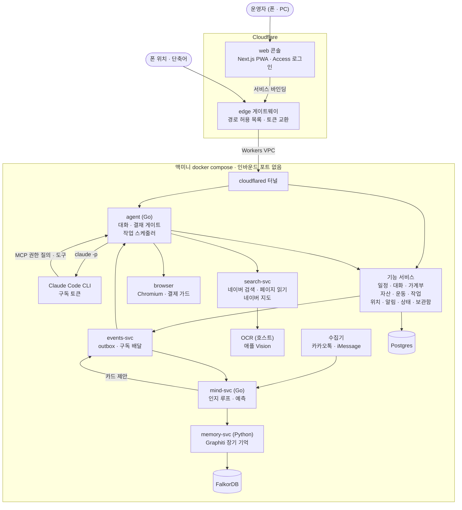
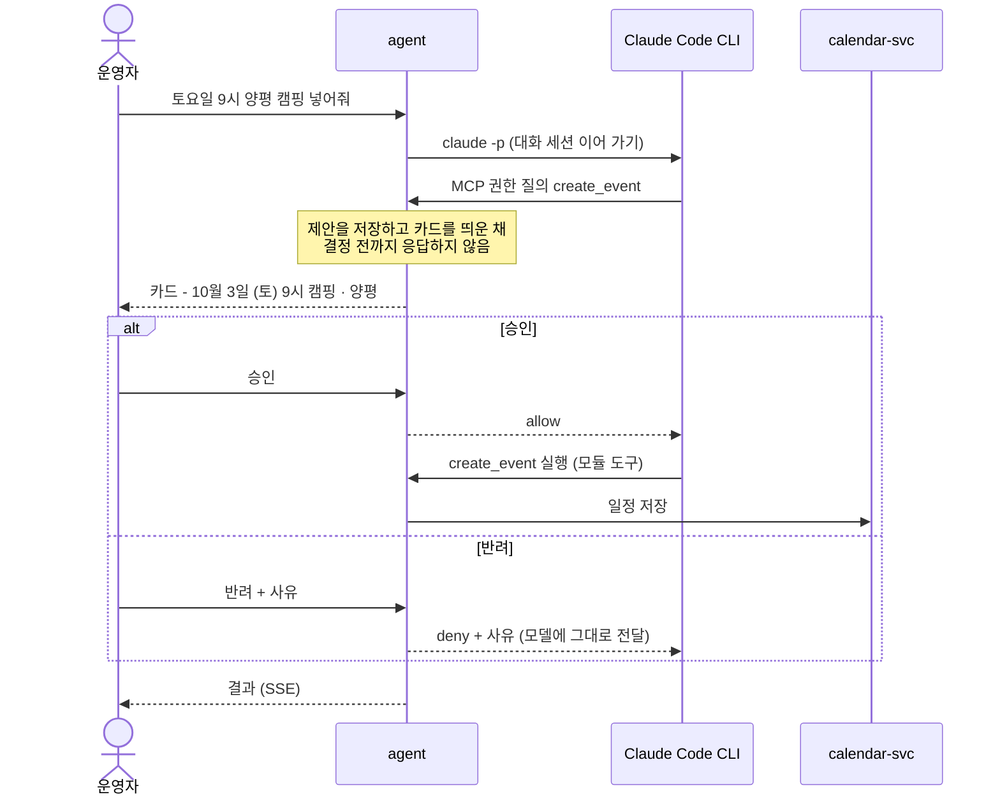

# jarvis

대화 하나로 일정·가계부·자산·브라우저 심부름을 맡기는 개인 AI 비서입니다.
**모델은 제안만 하고, 무언가를 바꾸는 일은 사람이 카드를 승인해야 실행됩니다.**

혼자 설계하고 만들어 2026년 9월부터 매일 쓰고 있습니다. 집의 맥미니에서 돌고, 인터넷을 향해 열린 포트는 하나도 없습니다.

- **기간** 2026-09-19 ~ 운영 중 · 1인 설계·개발·운영 (Claude Code 활용)
- **규모** 커밋 245개 · Go 약 7만 줄 · TypeScript 약 3만 줄 · Python 약 4천 줄 · SQL 마이그레이션 63개 (2026-10-22 기준, 테스트 포함)
- **구성** Cloudflare Workers 2개(웹 콘솔·게이트웨이) + 맥미니 docker compose 컨테이너 20여 개
- **검증** Go·Python 테스트 파일 116개, 인지 루프 평가 시나리오 63개
- **스택** Go · Next.js(TypeScript) · Python · PostgreSQL · FalkorDB · Docker Compose · Cloudflare Workers / Workers VPC / Access · Claude Code CLI · MCP

## 할 수 있는 일

| 영역 | 예 |
|---|---|
| 일정 | "토요일 9시 양평 캠핑 넣어줘" → 카드 `10월 3일 (토) 09:00 캠핑 · 양평` 승인 → 공유 캘린더에 저장. 카카오톡 대화에서 약속이 확정되면 먼저 "캘린더에 넣을까요?"라고 묻습니다 |
| 가계부 | 카드사 카카오톡 알림을 읽어 자동으로 기록합니다. 분류를 모르는 결제만 카드로 묻고, 쿠팡 결제는 브라우저로 주문 목록을 읽어 상품별로 나눕니다 |
| 자산 | 업비트·한국투자증권·금 조회. 목표 비중에서 벗어나면 리밸런싱 카드를 올립니다 |
| 브라우저 심부름 | 맡긴 일을 백그라운드 작업으로 돌립니다. 결제 직전에 카드를 올리고, 승인하면 보안 키패드 비밀번호까지 넣어 결제를 끝냅니다 |
| 찾아보기 | 네이버 블로그·뉴스·카페·웹을 함께 찾고, 페이지 속 그림(이벤트 카드·높이 2만 픽셀의 상품 상세 이미지)에 쓰인 글자까지 읽어 답합니다. 근처 가게는 네이버 지도의 영업 상태·마감 시각·별점으로 찾습니다 |
| 먼저 말 걸기 | 결제·운동·사진·위치·대화에서 생활 패턴을 찾아 제안합니다 - "11/15 캠핑. 지난번엔 3일 전에 장작을 샀어요. 담아둘까요?" 야외 일정에 비 예보가 있으면 맑은 날로 옮기자고 묻습니다 |
| 그 밖에 | 장기 기억(지식 그래프), 운동 기록, 사진(Immich), 웹 푸시 알림, 목소리 복제 TTS, 캘린더만 쓰는 손님 계정 |

## 구성



- 웹 콘솔과 게이트웨이만 Cloudflare 에 있고 나머지는 전부 맥미니에 있습니다. 터널은 바깥으로 나가는 연결만 맺습니다.
- 기능 서비스는 디렉터리 하나·이미지 하나·Postgres 역할 하나입니다. 에이전트에는 저장소가 없고 **결정**만 남았습니다 - 카드, 도구 스키마, 되돌릴 수 있는지의 선언, 실시간 스트림.

## 설계에서 풀어 낸 문제

### 1. 모델은 제안만 한다 - 결재 게이트

LLM 에게 캘린더 쓰기나 결제 같은 도구를 주면 실행 시점을 모델이 정합니다. 실행 직전에 사람이 끼어들 자리가 필요했습니다.

Claude Code CLI 의 `--permission-prompt-tool` 로 권한 질의를 에이전트의 MCP 엔드포인트로 돌리고, 그 핸들러가 **사람이 결정할 때까지 반환하지 않게** 했습니다. 이 플래그는 `--help` 에 없는 숨은 플래그라 실제 컨테이너에서 동작을 확인하고 썼습니다.



- **제안은 대화의 속성이 아니라 저장되는 객체입니다.** 그래서 대화 중의 권한 질의뿐 아니라 백그라운드의 인지 루프(mind)도 같은 카드를 올릴 수 있습니다.
- **선언 하나가 세 곳을 정합니다.** 모듈이 동작을 `action.Spec` 으로 선언하면 MCP 도구 스키마, 카드 문구, 되돌릴 수 있는지(`Reversible`)가 한꺼번에 정해집니다. 되돌릴 수 없는 동작은 신뢰도가 아무리 높아도 카드를 거칩니다.
- **우회로를 없앴습니다.** 캘린더가 에이전트 작업 폴더의 JSON 파일이던 때는 CLI 의 `Read`/`Write` 도구가 카드를 건너뛰는 두 번째 문이었습니다. 저장소를 서비스로 빼서 에이전트의 파일시스템에 캘린더가 아예 없게 했습니다.
- **카드 피로를 줄였습니다.** 운영하면서 카드는 바꾸는 일(일정 추가·수정·삭제, 로그인 저장)과 결제에만 남기고, 조회 도구는 모듈이 선언한 목록으로 자동 허용했습니다. 카드 본문은 JSON 이 아니라 "항목: 값" 줄로 그립니다.
- **함정:** CLI 의 MCP 타임아웃은 밀리초 단위라, 초로 넘기면 한도가 1.8초가 되어 "승인은 됐는데 실행은 안 되는" 상태가 됩니다. 대기 예산을 사람이 기다릴 수 있는 시간보다 크게 잡았습니다.

### 2. 결제는 도구가 아니라 요청을 본다 - 브라우저 가드

`browser_click` 은 조회 버튼이든 결제 버튼이든 같은 호출이라, 도구 층에서는 결제를 가려낼 수 없습니다.

- 같은 Chromium 에 CDP 로 따로 붙은 감시자([`browser/guard.py`](browser/guard.py))가 브라우저가 **실제로 보내려는 요청**을 `Fetch` 로 멈춰 세웁니다. 정해 둔 결제 수단으로 가는 요청은 카드를 띄우고 그 밖의 간편결제는 묻지 않고 막습니다. 반려하면 요청이 취소되는 것이 아니라 애초에 나가지 않습니다. 어떤 도구가 눌렀든 걸립니다.
- 쿠팡 주문서는 결제수단 선택과 결제하기가 같은 주소로 가서, 요청 본문의 이벤트 이름으로 둘을 가립니다.
- 결제 승인은 그 작업에만, 그 사이트를 30분 동안 엽니다. 대화나 다른 작업에는 열리지 않습니다.
- 아무도 보지 않는 백그라운드 작업은 탭이 작업의 사이트 밖으로 나가면 막습니다. 읽은 페이지가 어디로 가라고 하든(프롬프트 인젝션) 로그인된 브라우저가 엉뚱한 곳에 가지 않게 하려는 것입니다.
- 쿠페이 보안 키패드는 숫자가 글자가 아니라 매번 배치가 섞이는 스프라이트 그림입니다. 그림을 칸마다 잘라 숫자를 읽고, 하나라도 확실하지 않으면 넣지 않습니다(틀리면 결제 비밀번호가 잠깁니다). 모델은 도구를 부르기만 하고 비밀번호를 보지 못합니다.
- 로그인 보관함([`vault-svc`](vault-svc/README.md))도 같은 원칙입니다. 저장은 카드의 비밀 칸으로 받고, 채울 때는 브라우저가 지금 탭의 도메인을 직접 읽어 **그 도메인에 저장된 것만** 받아 넣습니다. 모델은 자격 증명을 한 번도 보지 않습니다.
- 결과: 대화로 맡긴 쿠팡 구매를 작업이 결제 카드 → 승인 → 키패드 입력까지 끝냈습니다(2026-10-18).

### 3. 먼저 말을 거는 비서 - 인지 루프 (mind-svc)

기능마다 "이럴 때 알려 줘"를 붙이면 알림이 늘수록 방해가 됩니다. 언제 말을 걸지 판단하는 곳이 하나여야 했습니다.

```
감지 → 관측 로그 → 해석 → 세계 모델 → 주의·스킬 → 자율성 관문 → 행동
                              ↑                                │
                              └─────── 행동의 결과도 관측 ──────┘
```

- **근거 없는 해석은 버립니다.** 카카오톡·iMessage 대화를 방이 조용해질 때 덩어리로 모델에 주고, 일정 변경마다 원문 줄 번호와 인용을 받습니다. 인용이 그 줄에 실제로 있어야 세계 모델에 반영합니다.
- **사람에게 닿는 문은 하나입니다.** 모든 제안이 자율성 관문을 지납니다. 최근에 같은 주제를 물었으면(제안 3일·승인 7일·거절 14일) 다시 묻지 않고, 하루 카드 5장·알림 8개로 묶고, (스킬, 맥락)별 승인율로 신뢰를 배웁니다. `확신 × 승인율 × 가치 > 방해 비용` 일 때만 지금 울리고, 아니면 저녁 요약으로 미룹니다. 세 번 연속 승인한 일은 그다음부터 실행하고 알리며, 되돌리면 다시 묻습니다.
- **예측은 모델 없이 셉니다.** 결제·운동·사진·위치·작업의 모든 발생을 일반에서 구체로 가는 키(`purchase` → `purchase/식비` → 가맹점)로 읽고, 밤마다 세 가지 꼴의 규칙을 찾습니다 - 요일(피셔 정확 검정), 주기, A 뒤의 B(이항 검정). 찾은 규칙은 그 이전 기록만으로 과거를 맞혀 보는 백테스트를 거친 뒤 "검증 중"으로 조용히 예측하고 채점받습니다. 평소 빈도만 아는 기준선보다 오차가 15% 이상 적고 60% 이상 맞혀야 화면에 보여 주고, 기준선보다 나빠지면 예측을 멈춥니다.
- **상식은 한 번만 묻습니다.** "이 장작이 그 캠핑을 위한 것인가"는 특정 구매가 아니라 (상품 분류, 일정 종류) 쌍으로 모델에 한 번 묻고 캐시합니다. 그 위에 시간 거리·배타성·반복을 규칙으로 곱합니다.
- **지금 상황**(어디서 누구와)도 결제·사진·일정으로 규칙 계산해 신뢰도와 함께 대화 매 턴 앞에 붙이고, 0.5 미만이면 추측하지 말고 묻게 합니다.

### 4. 프롬프트는 평가로 바꾼다

- 정답이 적힌 대화 시나리오 63개([`mind-svc/internal/eval/scenarios`](mind-svc/internal/eval/scenarios))를 기록된 모델 응답으로(모델 없이, 결정적) 또는 실제 모델로 돌립니다.
- 정확도만이 아니라 비서다움을 잽니다: 예측의 Brier 점수, 답한 카드의 승인율, 카드가 나온 날의 하루 방해 횟수.
- 프롬프트나 모델을 바꾸면 실제 모델 평가부터 돌립니다. 예: 2026-10-11 Haiku 5.5 로 당시 12개 시나리오를 3번 연속 모두 통과, 회당 약 $0.007.

### 5. 구독 안에서 돌린다 - 비용 설계

- 대화와 작업은 API 가 아니라 Claude Code CLI(`claude -p`)를 구독 토큰으로 실행합니다. 환경에 `ANTHROPIC_API_KEY` 가 있으면 에이전트가 부팅을 거부해, 종량 과금으로 조용히 새는 길을 막습니다.
- 요청마다 도구 정의·지시·대화 기록 전체가 실리므로 프롬프트 캐시가 깨지지 않게 짰습니다. 지시문은 고정하고 시각·상황 같은 값은 메시지 앞에만 붙이며 직전과 같으면 생략합니다. 오래 쉬었거나 기록이 커지면 최근 대화만 들고 새 세션을 엽니다. 대화에 싣는 내장 도구도 줄였습니다.
- 턴마다 입력·캐시 읽기·캐시 쓰기·출력 토큰을 로그로 남기고, 세션 교체 시점과 캐시 수명은 그 숫자로 정했습니다.
- 백그라운드 작업은 대화와 분리된 세션에서 Sonnet 으로 돌고, 잘 끝나지 않은 작업만 Opus 로 다시 돕니다.

### 6. 집 서버를 열지 않고 밖에서 쓴다 - 인프라와 보안

- **인바운드 포트 0.** `cloudflared` 터널은 바깥으로 나가는 연결만 맺고, 게이트웨이 Worker 가 Workers VPC 바인딩으로 그 터널을 타고 compose 서비스 이름으로 닿습니다.
- **토큰을 층마다 나눴습니다.** 웹 Worker 는 게이트웨이용 토큰만 갖고, 게이트웨이가 경로 허용 목록을 확인한 뒤 서비스용 토큰으로 바꿔 붙입니다. 손님 토큰은 손님 에이전트·운동·알림 경로만 엽니다. 공개 주소로는 폰의 위치 보고 같은 몇 개 경로만 열려 있습니다.
- **서비스마다 DB 역할.** 서비스는 각자의 Postgres 역할(`svc_*`)로 붙고, 마이그레이션은 새 표와 같은 파일에 권한을 적습니다. `scripts/dbtest` 가 일회용 DB 에 마이그레이션을 전부 올리고 서비스별 역할로 테스트해 권한 누락을 잡습니다.
- **격리와 복구.** 데이터베이스와 브라우저는 각자의 Docker 네트워크에만 두고, 수집기와 브라우저는 root 가 아닌 사용자로 돕니다. 매일 백업하고 복원까지 시험합니다.
- **관측.** 서비스 사이의 소식은 `events-svc` 의 outbox 와 구독 배달로 흐르고, 상태 탭이 기능별 판정과 호스트 점검(백업·미러 등)을 한 화면에 보여 줍니다.
- 카카오톡·iMessage 는 맥의 앱 DB 를 읽기 전용으로 읽기만 하고 앱에는 쓰지 않습니다.

### 7. 화면 - 채팅방이 아니라 기록물

- 폰에서 주로 쓰는 PWA 입니다. 대화 · 일정 · 가계부 · 자산 · 운동 · 사진 · 편집(브라우저에서 도는 이미지 편집기 [PhotoCraft](https://github.com/storytold/photocraft)) · 생활 · 위치(하루 동안 다닌 길 되감기) · 작업 · 화면(브라우저 원격 보기) · 상태 탭이 있습니다.
- 상대가 하나뿐인 스레드라 목록과 아바타를 버리고, 에이전트의 말은 말풍선 없이 문서처럼 흐르게 했습니다. 화면이 답해야 할 질문은 "지금 내 결정을 기다리는 게 있나" 하나입니다.
- 무채색 한 줄기에 의미가 있을 때만 쓰는 신호색 셋(승인·반려·연결). 글자 대비는 실측해 맞췄습니다(흐린 글자 2.95:1 → 4.54:1). 근거는 [web/DESIGN.md](web/DESIGN.md)에 있습니다.

## 저장소 구조

```
agent/              대화 · 결재 게이트 · 모듈 · 작업 스케줄러 (Go)
mind-svc/           인지 루프 · 예측 엔진 · 평가 시나리오 (Go)
web/                콘솔 (Next.js, Cloudflare Workers)
edge/               게이트웨이 Worker
browser/            에이전트의 Chromium - 결제 가드 · 키패드 · 로그인 브리지 (Python)
*-svc/              기능 서비스 - 일정 · 대화 · 운동 · 자산 · 가계부 · 작업 · 위치
                    · 알림 · 이벤트 · 상태 · 보관함 · 장기 기억
kakaotalk-client/   카카오톡 수집기 (맥 앱 DB 읽기 전용)
imessage-client/    iMessage 수집기
tts/                목소리 복제 TTS (Qwen3-TTS, MLX, 맥미니 호스트)
search-svc/         웹 찾기 - 네이버 검색 · 페이지와 그림 속 글자 · 네이버 지도 (Go)
ocr/                그림 속 글자 읽기 (Swift, 애플 Vision, 맥미니 호스트)
db/                 마이그레이션과 서비스별 역할
gocommon/           Go 공통 코드 (outbox, 수집기 인증·보존)
scripts/            맥미니 배포 · 백업 · DB 테스트
```

## 더 읽을 거리

- [agent/README.md](agent/README.md) - 결재 게이트와 모듈의 세부, 구독 사용량 설계, 에이전트 API, 로컬 실행
- [mind-svc/README.md](mind-svc/README.md) - 인지 루프의 층별 설계와 평가 시나리오
- [vault-svc/README.md](vault-svc/README.md) - 모델이 보지 못하는 로그인 보관함
- [search-svc/README.md](search-svc/README.md) - 한국 웹을 찾고, 그림 속 글자까지 읽는 법
- [web/DESIGN.md](web/DESIGN.md) - 화면의 색·타이포·레이아웃 근거
- [DEPLOY.md](DEPLOY.md) - Cloudflare 와 맥미니 배포
- [db/README.md](db/README.md) - 스키마와 서비스별 DB 역할

개인 운영용이라 카카오톡 DB 키, 증권사 키, 공유 캘린더 토큰 같은 계정·기기 연결이 전제입니다.
직접 띄워 보려면 [agent/README.md](agent/README.md)의 실행 절차와 [DEPLOY.md](DEPLOY.md)를 보세요.
